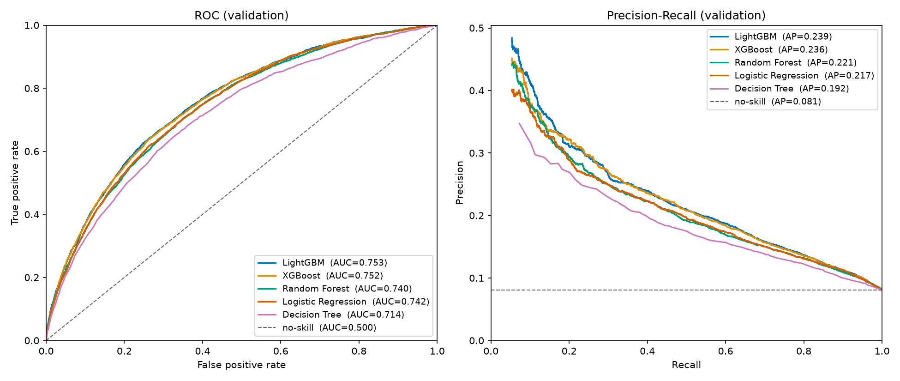

# 🏦 Home Credit Default Risk Prediction

> Predicting the probability that a loan applicant will have repayment difficulties, using an end-to-end Machine Learning workflow on 307,511 real loan applications.

## 📌 Project Overview

A lender has to decide which applicants can repay a loan. Approving a future defaulter costs money; rejecting a good applicant costs a customer. This project builds a binary classifier that estimates $P(\text{TARGET}=1 \mid X)$, the probability of payment difficulties, so applicants can be ranked by risk.

| Phase | Status |
| --- | --- |
| Exploratory Data Analysis | ✅ Done |
| Preprocessing and Feature Engineering | ✅ Done |
| Model Development and Tuning (5 models) | ✅ Done |
| Final Evaluation and Threshold Selection | 🔜 Planned |
| Interpretability (SHAP) | 🔜 Planned |

## 📊 Dataset

[Home Credit Default Risk – Kaggle](https://www.kaggle.com/competitions/home-credit-default-risk): `application_train.csv`, 307,511 applicants × 122 columns. The Kaggle test file has no target, so the training file is split **70/15/15** (stratified) into training, validation, and test sets.

Only **8.1%** of applicants defaulted. A model that approves everyone would be 92% accurate, so accuracy is not used.

## 🔍 Approach

- **[EDA](notebooks/01_eda.ipynb):** missing values are mostly structural, not random. `DAYS_EMPLOYED` hides a placeholder value. External credit scores are by far the strongest predictors.
- **[Preprocessing](notebooks/02_preprocessing.ipynb):** credit-to-income and instalment-to-income ratios, plus flags for informative missing values. There are two scikit-learn pipelines, one for linear models and one for tree models. Both are refitted inside every cross-validation fold to avoid **data leakage**.
- **[Modeling](notebooks/03_modeling.ipynb):** five models tuned on the same 5-fold stratified cross-validation inside the training set, with class weights for the imbalance. They are then compared on the held-back validation set by **PR-AUC**, which focuses on the minority class (a random model scores 0.081), with **ROC-AUC** for comparison with Kaggle.
- **Interpretability:** Logistic Regression odds ratios and Random Forest feature importance so far; SHAP is planned.

## 📈 Results

Hyperparameters are tuned by 5-fold cross-validation **inside the training set**. The validation set is held back from tuning entirely and used only to compare the five tuned models.

| Model | CV PR-AUC | Val PR-AUC | CV ROC-AUC | Val ROC-AUC |
| --- | --- | --- | --- | --- |
| **LightGBM** | **0.240 ± 0.007** | **0.239** | **0.757** | **0.753** |
| XGBoost | 0.239 ± 0.007 | 0.236 | 0.754 | 0.752 |
| Random Forest | 0.223 ± 0.008 | 0.221 | 0.744 | 0.740 |
| Logistic Regression | 0.221 ± 0.010 | 0.217 | 0.746 | 0.742 |
| Decision Tree | 0.193 ± 0.007 | 0.192 | 0.718 | 0.714 |



LightGBM ranks first at roughly 3× the 0.081 no-skill rate, but its lead over XGBoost is 0.003 PR-AUC on validation — far inside the ±0.007 spread across folds. The two boosters are tied in practice, and the choice between them rests on training cost: 5.3 minutes against 7.6 for the same search budget.

Logistic Regression is the result worth noting. It trails Random Forest by 0.004 PR-AUC and edges ahead of it on ROC-AUC, while scoring only 0.002 higher on the data it was fitted to than on held-out folds — it is not overfitting at all. The boosters, by contrast, score about 0.05 higher on their own training data. They buy roughly 0.02 PR-AUC over the linear model, which is real but modest for the loss of a readable one.

Validation scores land below cross-validated scores for all five models, on both metrics, by 0.001 to 0.004. That gap is the optimism left over from choosing each family's winner on the same folds that scored it. It is small here, and it is the reason the comparison is reported on data the tuning never touched.

🔜 The selected model will be tested once on the held-out set. Precision, recall and the confusion matrix will be reported at a threshold chosen on business costs.

## 📝 Future Work

- [ ] Test-set evaluation and threshold optimization
- [ ] Probability calibration
- [ ] SHAP explainability

## 📂 Repository Structure

```text
├── notebooks/
│   ├── 01_eda.ipynb                # ✅ exploratory analysis
│   ├── 02_preprocessing.ipynb      # ✅ cleaning, features, pipelines
│   ├── 03_modeling.ipynb           # ✅ modeling, comparison
│   └── 04_interpretability.ipynb   # 🔜 SHAP
├── data/  
    ├── raw                     # raw data from Kaggle
    └── processed               # processed data (train/val/test)
├── models/                     # saved pipelines & models
├── reports/figures/
└── requirements.txt
```

## 💻 Installation and Usage

```bash
git clone https://github.com/Edo-analyst/home-credit-default-risk.git
cd home-credit-default-risk
python -m venv venv && source venv/bin/activate   # Windows: venv\Scripts\activate
pip install -r requirements.txt
```

Download `application_train.csv` from [Kaggle](https://www.kaggle.com/competitions/home-credit-default-risk/data) into `data/raw/`, then run the notebooks in order.

**Tech stack:** Python · pandas · NumPy · scikit-learn · XGBoost · LightGBM · SHAP · Matplotlib · Seaborn · Jupyter